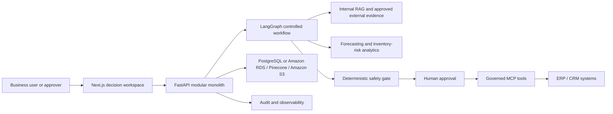

# Enterprise Decision Intelligence Platform (EDIP)

EDIP Version 2 is the approved architecture for a trustworthy enterprise decision-intelligence platform: grounded evidence, forecasting, governed agent workflows, deterministic controls, and accountable human decisions.

> **Current status:** The governed Favorita forecasting baseline, local load-only FastAPI forecast path, and offline uncertainty implementation are present. Their bounded validation is documented separately. Real-data uncertainty results and the broader governed RAG and workflow targets are not established by those implementations. Legacy synthetic forecast, RAG, and demo workflow runtimes have been retired.

EDIP is not currently production-ready. Capabilities below are explicitly distinguished as current, approved target, or future work.

## Vision and positioning

Operational teams often have data and dashboards but still lack a defensible path from evidence to action. EDIP is intended to help inventory, supply-chain, operations, risk, and technology stakeholders determine:

- forecast inventory risk and its uncertainty;
- which internal and approved market evidence supports a recommendation;
- whether evidence is sufficient to decide or the system should abstain; and
- which actions require human approval and what was ultimately executed.

The flagship engineering goal is a reviewable enterprise platform rather than an unconstrained chatbot. Its target decision-support direction is: **Trustworthy Human-in-the-Loop multi-agent systems for safe, explainable, and auditable decision-making.**

## Status and evidence boundary

| State | Meaning |
|---|---|
| **Current implemented state** | Governed Favorita data/feature and forecasting workflows, model-bundle/load-only API code, offline uncertainty code with synthetic validation, a Next.js UI baseline, and deployment/monitoring assets exist. Real-data uncertainty execution and integrated decision workflows are not established. |
| **Approved target architecture** | A capability-oriented modular monolith, LangGraph workflows, governed retrieval and integrations, deterministic safety controls, durable audit, and Amazon Web Services (AWS) deployment define V2. |
| **Future implementation** | Remaining baseline gaps and later capabilities require implementation, integration, evaluation, security, and validation through explicit acceptance gates. Existing components must be assessed before their work is treated as pending. |

There is no claim here of complete test-suite health or live Pinecone, OpenAI, AWS, or ERP/CRM operation.

## Approved V2 capabilities

- **Next.js frontend** for decision workspaces, evidence review, uncertainty display, approvals, and audit views.
- **FastAPI capability-oriented modular monolith** with explicit module boundaries; microservices are not the initial design.
- **LangGraph workflows** for durable, stateful, controlled orchestration.
- **Internal RAG with Pinecone** for tenant-scoped retrieval from governed enterprise knowledge.
- **Forecasting and inventory-risk analytics** with versioned data, models, metrics, and uncertainty evidence.
- **Approved external evidence** through a governed source registry, provenance, freshness, and citation controls.
- **Internal-to-market benchmarking** that keeps internal facts distinct from external evidence.
- **Deterministic safety gate** for critical calculations, policy checks, evidence sufficiency, and abstention.
- **Human-in-the-Loop (HITL) approval** before controlled, consequential execution.
- **Governed MCP integrations** for bounded ERP/CRM tools; LLMs must not authorize irreversible actions.
- **Durable audit and observability** using PostgreSQL business records, LangSmith traces, Prometheus/Grafana, and Amazon CloudWatch with distinct ownership.
- **AWS deployment direction** using Amazon ECR and Amazon ECS Fargate as the canonical production target.

Kafka and Airflow are not mandatory V2 core components. They remain gated future options only if measured scale, scheduling, or event-processing needs justify their operational cost. Kubernetes is optional learning evidence, not the canonical deployment target.

## Architecture principles

- Trustworthy decisions require traceable evidence, uncertainty, abstention, and human accountability.
- Critical calculations and safety policies remain deterministic and testable.
- LLM output is advisory; it cannot directly authorize irreversible business actions.
- Tenant identity, RBAC, source approval, and audit context cross every capability boundary.
- The initial architecture is a capability-oriented modular monolith, not microservices.
- Python remains in the existing `app/` layout; no migration to a `src/` layout is planned.
- Online RAG and workflows will move to `app/rag/` and `app/workflows/` as contracts stabilize.
- Offline ingestion and model training remain under `pipelines/`.
- Forecasting migrates only after its artifacts, interfaces, and tests are stable.
- Generated datasets and artifacts stay outside Git, with manifests, versions, provenance, and checksums.
- LangSmith supports workflow observability but is not the authoritative business audit store.
- AWS is canonical; detailed topology requires a dedicated Architecture Decision Record (ADR) and evidence-backed implementation.

## Architecture at a glance



See the [EDIP V2 Flagship Architecture Plan](docs/architecture/EDIP_V2_FLAGSHIP_ARCHITECTURE_PLAN.md) for complete boundaries, decisions, diagrams, gates, risks, and acceptance criteria.

## Phased V2 roadmap

1. **Phase 0 — completed:** establish repository truth, audit the baseline, and complete controlled cleanup.
2. **Phase 1 — Stable local baseline (acceptance pending):**
   - one supported Python runtime;
   - dependency reconciliation;
   - clean application and LangGraph imports;
   - full pytest collection;
   - controlled PostgreSQL initialization;
   - deterministic fixtures; and
   - API container startup and health/readiness smoke checks.
3. **Evidence and RAG:** implement governed ingestion, Pinecone retrieval, citations, evidence sufficiency, and retrieval evaluation.
4. **Analytics:** stabilize forecasting artifacts and tests, then add uncertainty-aware inventory-risk capability.
5. **Workflow and safety:** implement LangGraph state, controlled stages, deterministic gates, and abstention.
6. **Approval and execution:** add durable HITL decisions and bounded MCP execution with idempotency and audit.
7. **Evaluation and operations:** validate retrieval, forecasts, workflows, decisions, safety, reliability, security, and Amazon ECS Fargate delivery.

Each phase requires documented evidence and review before the next stable checkpoint is merged.

## Engineering framework alignment

EDIP adopts the [Enterprise AI/ML Engineering Framework](https://github.com/chathuranga-sudusinghe/enterprise-ai-ml-engineering-framework) as an evidence lifecycle:

**Problem → Data → Baseline → Advanced AI → Evaluation → Delivery → Production → Maintenance**

The architecture plan maps each stage to EDIP gates, required artifacts, validation evidence, approval boundaries, and review outcomes. Advanced AI follows adequate problem, data, and baseline evidence; deployment assets alone do not establish production readiness.

## Engineering evidence and traceability

Engineering claims require defined objectives, governed inputs, reproducible methods,
proportionate validation, security and operational evidence, and explicit limitations.
The forecasting foundation is documented in the [experiment design](docs/forecasting/favorita/FAVORITA_FORECASTING_EXPERIMENT_DESIGN.md),
[metric contract](docs/forecasting/favorita/FAVORITA_FORECASTING_EVALUATION_METRICS.md),
[temporal design](docs/forecasting/favorita/FAVORITA_TEMPORAL_VALIDATION_DESIGN.md),
[temporal contract](docs/forecasting/favorita/FAVORITA_TEMPORAL_VALIDATION_CONTRACT.md),
and [offline uncertainty baseline](docs/forecasting/favorita/FAVORITA_FORECAST_UNCERTAINTY.md).
The uncertainty implementation has synthetic validation; real-data interval coverage
and width results have not been produced for Issue #128.

The traceability chain is: **finding → risk → decision → implementation → validation → outcome → reflection**.

## Repository structure

```text
app/          FastAPI application and current online capabilities
ui/           Next.js frontend
pipelines/    Offline ingestion, training, and evaluation workflows
tests/        Automated test assets
docs/         Architecture, audits, runbooks, and evidence
monitoring/   Prometheus and Grafana assets
infra/        Deployment and infrastructure assets
```

Some directories reflect the pre-V2 implementation. Their presence is evidence of repository assets, not proof that every component is integrated or operational.

## Local setup and usage

### Backend

Use Python 3.12, the supported EDIP runtime for local development, CI, and Docker.

```bash
python -m venv .venv
```

Activate the environment, then install and start the API:

```bash
python -m pip install -e ".[dev]"
uvicorn app.main:app --reload
```

Runtime-only installations use `python -m pip install .`; non-editable development installations use `python -m pip install ".[dev]"`. Python metadata, pinned dependencies, and tool configuration live in `pyproject.toml`. Ruff supplies linting, import sorting, and formatting; Black and isort are not required. MyPy targets `app` and `pipelines`; this newly documented scope still has existing type errors. Formatting also has existing failures, so these checks are not yet CI gates.

Use editable installation for local pipeline work so repository-relative data and artifact defaults retain their meaning. For an installed wheel outside the checkout, configure absolute runtime paths (`EDIP_FAVORITA_SOURCE_PATH`, `EDIP_ARTIFACT_ROOT`, and `EDIP_FAVORITA_MODEL_BUNDLE_PATH`) as needed.

Open `http://localhost:8000/docs` for generated API documentation. The local load-only forecast path and its validation boundary are described in [the inference validation record](docs/validation/FAVORITA_REAL_MODEL_INFERENCE_VALIDATION.md). That evidence does not establish public forecast access, RAG, or governed decision workflows.

### Frontend

```bash
cd ui
npm install
npm run dev
```

Open `http://localhost:3000`. The current frontend is an existing baseline and does not yet represent the complete approved V2 decision workspace.

### Tests and checks

```bash
ruff check .
ruff format --check .
mypy
pytest
cd ui
npm run lint
npm run build
```

These are contributor commands, not a claim that the entire suite currently passes in every environment. Consult the audit evidence and run relevant checks for each change.

## Current known limitations

- The local Python import and test baseline is established, but controlled PostgreSQL initialization and API container health/readiness still require validation.
- No active RAG implementation or corpus is present; governed ingestion, retrieval, isolation, freshness, citation, and evaluation capabilities require a new implementation.
- LangGraph remains a declared foundation dependency, but orchestration, evidence-sufficiency rules, abstention, durable HITL resume, and deterministic execution gates require a new implementation and validation.
- Local load-only Favorita forecasting and model-bundle validation are recorded. Production publication, promotion, and serving claims require separate revision-specific artifact and deployment evidence; local validation does not establish those states.
- External evidence needs an approved source registry and provenance, freshness, licensing, and injection-resistance controls.
- MCP ERP/CRM actions require allow-listed tools, least privilege, schema validation, idempotency, approval binding, and reconciliation testing.
- AWS is the approved deployment direction and deployment assets are present. Actual environment state must be established from deployment evidence; see the [backend deployment runbook](docs/deployment/EDIP_BACKEND_FIRST.md) for controls and recorded limitations. This documentation update performs no live verification.
- Existing tests, CI, monitoring, Kubernetes, and Terraform assets vary in maturity and do not demonstrate integrated production operation. Kafka and Airflow remain gated future options; the legacy demo assets are not part of the active runtime.

## Authoritative documents

- [EDIP V2 Flagship Architecture Plan](docs/architecture/EDIP_V2_FLAGSHIP_ARCHITECTURE_PLAN.md)
- [AWS Canonical Cloud Migration Audit](docs/audits/EDIP_AWS_CANONICAL_CLOUD_MIGRATION_AUDIT.md)
- [EDIP Engineering Delivery Workflow](docs/governance/EDIP_RESEARCH_ENGINEERING_DELIVERY_WORKFLOW.md)
- [Favorita Dataset Source and Governance](docs/governance/FAVORITA_DATASET_SOURCE_AND_GOVERNANCE.md)
- [All repository audits](docs/audits/)

## Contribution workflow

V2 work integrates through `dev`, using short-lived branches from `dev`. Reviewed phase checkpoints move from `dev` to `main`; `main` represents reviewed stable checkpoints. Architecture-significant decisions require an ADR, validation evidence, and stakeholder review.

## Responsible AI use

AI-assisted development may support drafting, review, tests, and documentation. Technical correctness, security, evidence quality, licensing, and professional judgement remain subject to human verification and acceptance under [AGENTS.md](AGENTS.md).

## License

EDIP is publicly available for portfolio, professional evaluation, educational review, and research-demonstration purposes. It is not distributed under an open-source license. Copyright © 2026 Chathuranga Sudusinghe. All rights reserved. See [LICENSE](LICENSE) for permitted and prohibited uses.

## Project statement

EDIP V2 is an approved architecture and a phased AI/ML engineering programme. It is not a claim of production readiness, complete integration, or completed Phase 1 delivery.
